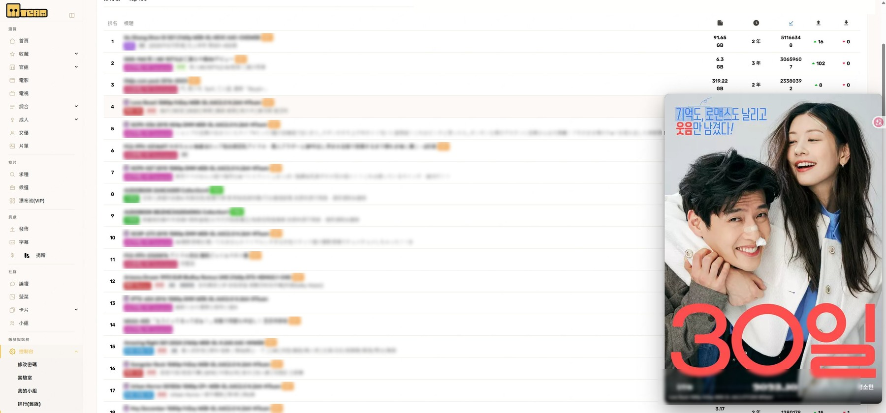
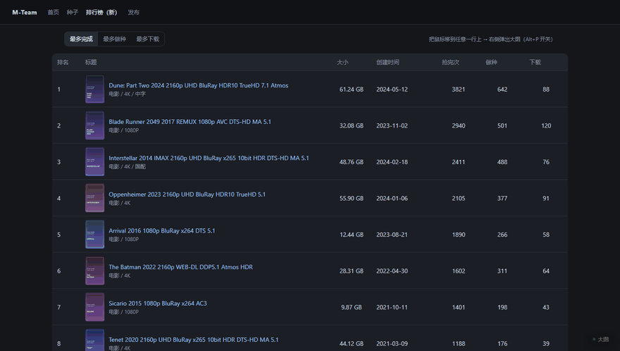

# M-Team Rankings Hover Preview

<p align="center">
  <a href="https://raw.githubusercontent.com/Eliaukzzz/m-team-rankings-hover-preview/main/m-team-rankings-hover-preview.user.js"></a>
</p>

<p align="center">
  <a href="https://github.com/Eliaukzzz/m-team-rankings-hover-preview/blob/main/LICENSE"></a>
  <a href="https://github.com/Eliaukzzz/m-team-rankings-hover-preview"></a>
  <a href="https://github.com/Eliaukzzz/m-team-rankings-hover-preview/stargazers"></a>
  
</p>

On M-Team's new [rankings page](https://kp.m-team.cc/rankings), hover any row and the torrent's **full-size poster** pops out beside it — no need to open detail pages one by one just to see the cover.



<sub>Real page, cursor resting on row 4. Torrent names are blurred on purpose; the account bar is cropped out of the frame.</sub>

## Why

The rankings page shows 100 torrents at a time with nothing but a title and one line of tags. To find out "what does this release look like", you have to open each detail page — and opening one takes you off the list, so you lose your place and have to scroll back down afterwards.

Worse, the new rankings table has **no thumbnails at all**: only a rank and the title text. So this cannot be done by enlarging an existing inline image — the poster has to be pulled from the data behind the page.

This script turns "take a peek at the poster" into a single hover: **no DOM surgery, no extra API calls, no account data touched**. It reads the cover URLs the page already received and floats the large image next to the row.

## Features

- **Poster from page data.** The new rankings table has no inline thumbnail, so the script gets the cover two ways: it hooks the site's own rankings XHR/Fetch response, or walks up the React fiber from the row to the torrent object, and takes `imageList[0]` from whichever hits. Only when both fail does it fall back to enlarging an inline image (old rankings page, card views).
- **Hover to peek.** Pops out after ~110ms and fades out after ~90ms off the row. The delay keeps fast cursor sweeps from flashing images all over the screen.
- **Smart placement.** Right of the row first; flips to the left when there is no room; if neither side fits it hugs the viewport edge and clamps vertically, so the poster is always **fully visible** and never clipped.
- **Large variant first.** The site often keeps both `xxx-1.jpg` (thumb) and `xxxjp-1.jpg` (full). The script tries the large one first and falls back automatically; if the loaded image is clearly too small and a bigger candidate exists, it swaps.
- **Caption on top.** A one-line title (clamped to two lines) is overlaid at the bottom of the poster so you know which release you are looking at.
- **Toggle on demand.** The "大图" button in the bottom-right corner, or `Alt + P`. The state is kept in `localStorage` across reloads. Holding `Alt` while hovering suppresses the preview for that moment (handy while dragging or selecting text).
- **Never in the way.** `pointer-events: none` — the preview does not eat mouse events. Scroll, tab switch, back/forward, or selecting text hides it immediately.

## Install

**First install a userscript manager**: [Tampermonkey](https://www.tampermonkey.net/) (or Violentmonkey / ScriptCat).

**Then click here to install the script**:

**<https://raw.githubusercontent.com/Eliaukzzz/m-team-rankings-hover-preview/main/m-team-rankings-hover-preview.user.js>**

Tampermonkey shows its install page — click *Install*. You can also drag [m-team-rankings-hover-preview.user.js](https://github.com/Eliaukzzz/m-team-rankings-hover-preview/blob/main/m-team-rankings-hover-preview.user.js) straight into a browser window, or paste it into a new script in the manager panel and press `Ctrl + S`.

Then open <https://kp.m-team.cc/rankings> and hover any row.

> Upgrading from an older version? **Reload the page once** after updating: the script has to hook the network before the page sends its first request, otherwise the first batch of rankings data is missed.

### Requirements

| Item | Requirement |
| --- | --- |
| Browser | Chrome / Edge / Firefox / Brave or any modern build with `PointerEvent` |
| Userscript manager | Tampermonkey 4.19+, Violentmonkey 2.13+, ScriptCat |
| Page | `https://kp.m-team.cc/rankings` (new rankings page), logged in |
| Viewport width | ≥ 720px (narrower screens cannot fit the preview, so it stays off) |

## Usage

| Action | Result |
| --- | --- |
| Hover a row | The torrent's poster pops out beside the row (after ~0.1s) |
| Move the cursor away | Fades out after ~90ms |
| `Alt + P` | Toggle the preview globally |
| Click the "大图" button | Same toggle, state is remembered |
| Hold `Alt` while hovering | No preview for that moment |
| Scroll the page | Preview hides immediately |

## Configuration

The `CONFIG` block at the top of the script is the only place to configure it. Edit, save, reload the page:

| Option | Default | Description |
| --- | --- | --- |
| `paths` | `['/rankings']` | Path prefixes where the script is active; add more as needed |
| `allPages` | `false` | `true` = active on every page of the site |
| `rowSelector` | `tr.ant-table-row, tr[data-row-key], table.table-fixed tbody tr` | Selector matching "one row" |
| `thumbMinSize` | `32` | Minimum visible edge of a thumbnail, filters out tiny icons (antd images and images inside detail links are exempt) |
| `showDelay` / `hideDelay` | `110` / `90` | Show / hide delay in ms |
| `maxWidthRatio` / `maxHeightRatio` | `0.46` / `0.68` | Maximum share of viewport width / height |
| `maxWidthPx` | `760` | Hard cap on preview width, in px |
| `minPreviewPx` | `140` | Minimum edge of the preview, in px, so ultra-wide art is not squashed flat |
| `gap` | `16` | Gap between preview and row, in px |
| `showCaption` | `true` | Show the title overlay at the bottom |
| `showToggleButton` | `true` | Show the bottom-right toggle button |
| `minViewportWidth` | `720` | Disabled below this viewport width |
| `preferLargeMinWidth` | `360` | If the loaded image is narrower than this, try a larger candidate |

Example — also enable the old rankings page at `/top` and make the preview smaller:

```js
paths: ['/rankings', '/top'],
maxWidthRatio: 0.4,
maxHeightRatio: 0.6,
```

## How it works

1. **Event delegation, not per-element binding.** Only `pointerover` / `pointerout` on `window` in the capture phase. The rankings page is an antd Table: changing the sort or category re-renders every row, so binding per element (the approach of the reference script, via `MutationObserver` + per-element `mouseenter`) is both wasteful and easy to miss on a 100-row list.
2. **Find the row.** `event.target.closest(rowSelector)`; anything whose `pointerType` is not `mouse` is ignored, so touch devices cannot trigger it by accident. The row id comes from `data-row-key` or from a `/detail/<id>` link in the row.
3. **Get the poster.** First look up `imageList[0]` for that id in the captured API data; if missing, climb the React fiber from the row and read the same field from `memoizedProps.torrent` / `memoizedProps.record`. Only if both fail does it fall back to the inline image (scored by `area × antd image × portrait`, cached per row in a `WeakMap`).
4. **Why hook the network at all.** The list data is fetched on first paint, so hooking at `document-idle` is already too late — hence `document-start`. To stay cheap it only wraps `XMLHttpRequest` and `fetch`, pre-checks each `/api/` response with `indexOf('imageList')` before parsing, and silently skips anything that fails. Page behaviour is unchanged; the requests themselves are not touched.
5. **Pick the large file.** Prefer `data-src` / `data-original` (common on lazy-loading sites), then `currentSrc` / `src`. Outside tables it also tries the `-123.jpg` → `jp-123.jpg` variant and falls back to the original. Every load carries an incrementing token, so stale results are dropped — sweeping across a dozen rows never shows the wrong poster.
6. **Position and fade in.** Set `display: block` first, then read `offsetWidth` / `offsetHeight` (forces layout, avoids measuring zero and jittering), compute `left/top` with a right → left → hug-the-edge fallback chain, and finally set `opacity` to trigger a 0.16s transition. It deliberately does **not** use `requestAnimationFrame` to reveal: in background tabs or headless environments rAF may not fire for a long time, which would leave the preview transparent forever.

## Adapting to other pages

- **Old rankings page `/top`**: `paths: ['/rankings', '/top']`.
- **Torrent lists and card views**: start with `allPages: true`. Card views usually also need a different `rowSelector`, for example `li.list-none` (the reference script uses `li.list-none .ant-image[role='button']`).
- **After a site redesign**: open the page with `?mthp_debug=1` and check the `[mthp]` console logs — `harvested N posters` is how many covers the hooked API yielded, `preview { from: 'api' | 'react' | 'thumb' }` is the source used for this hover, and `no poster found` means neither path matched.

## FAQ

**The rows have no thumbnails — where does the poster come from?**<br>
The page renders without thumbnails, but the rankings API response contains `imageList` for each torrent. The script records `id → cover URL` when that response arrives and looks the row up on hover; if the lookup misses, it walks the React data instead. No new requests are made at any point.

**Hovering does nothing.**<br>
Check in order: the URL is `/rankings` (limited by `CONFIG.paths`) → the window is at least 720px wide → the bottom-right button reads "大图" rather than "大图 关" → **did you reload the page after updating** (the script must run at `document-start`) → another M-Team script is not interfering (disable the others to test).

**Still nothing — how do I debug?**<br>
Add `?mthp_debug=1` to the URL and open the console: no `harvested` line means the API call was not captured (the site may have changed how it fetches); `harvested` but no `preview` line means the row id did not match (the table markup may have changed). Paste the log into an issue.

**The preview covers the right-hand columns.**<br>
When the rankings table fills the screen the preview can only sit on top of it (`pointer-events: none`, so clicks still go through). Lower `maxWidthRatio` to `0.35` or `maxWidthPx` to `480` and it gets much better.

**Does it use extra bandwidth?**<br>
Each image is loaded once, on first hover, and then comes from the browser cache; rows you sweep past without pausing never load anything. Apart from the images themselves there are no network requests — the hook only reads responses the page already received.

**Does it send my data anywhere?**<br>
No. The script does not read cookies, does not make requests, does not inject remote code — all logic is local, and the on/off state is written to `localStorage` only.

**Does it work on mobile?**<br>
Basically no: touch screens have no hover, the script filters out non-mouse pointers, and narrow viewports (< 720px) turn it off.

## Local development

The repository ships with a demo page that mimics the rankings table, so you can tweak the styling without logging into M-Team or re-testing against the live site:

```bash
git clone https://github.com/Eliaukzzz/m-team-rankings-hover-preview.git
cd m-team-rankings-hover-preview
node demo/serve.mjs          # needs Node 18+
# open http://localhost:8123/rankings
```

The demo deliberately mirrors the real thing: rows contain a title only, no thumbnail, and the posters come from a fake `/api/torrent/search` served by `demo/serve.mjs` — so the whole "hook the API → look up → show the poster" path is exercised. Append `?autohover=3` to hover row 3 automatically after load, which is handy for screenshots and regression checks.



<sub>The GIF above was recorded on the demo page (fake data, rows also carry no thumbnail).</sub>

## Project structure

```
m-team-rankings-hover-preview/
├── m-team-rankings-hover-preview.user.js   # the script itself (install this one)
├── demo/
│   ├── index.html                          # rankings look-alike (calls the fake API, renders no thumbnails)
│   ├── serve.mjs                           # static server + fake /api/torrent/search
│   └── posters/                            # sample posters for the demo
├── docs/
│   ├── preview.jpg                         # real-page screenshot (hero image)
│   └── demo.gif                            # demo page recording
├── LICENSE
└── README.md
```

## Changelog

- **1.2.0** — Fixed "nothing happens on the rankings page after installing". The new rankings table has no thumbnails, so the poster now comes from `imageList` in the hooked API response / React data; `@run-at` moved to `document-start` so the first batch of data is captured; the inline-thumbnail path is kept as a fallback.
- **1.1.1** — Completed the script header (`@author` / `@namespace` / `@homepageURL`); documentation cleanup.
- **1.1.0** — Switched to event delegation; support for `data-src` and other lazy-loading attributes; large-variant fallback and automatic upgrade when the loaded image is too small; removed the `requestAnimationFrame` dependency; portrait images weighted higher.
- **1.0.0** — First usable release: hover preview, edge-aware placement, title overlay, `Alt + P` toggle.

## Credits

- Interaction model and selector ideas inspired by [M-Team New UI — List Image Preview](https://greasyfork.org/zh-CN/scripts/538074) by [Seahor](https://github.com/SeahorZhang/m-team-thems). This script is an independent implementation and uses a lighter delegation-based approach for the rankings page.
- Class names, table structure and API field names come from reading the `kp.m-team.cc` frontend bundle; after a site redesign the selectors may need adjusting.

## License

[MIT](LICENSE) © Eliaukzzz

If this script saved you a few clicks, a ⭐ is appreciated.
