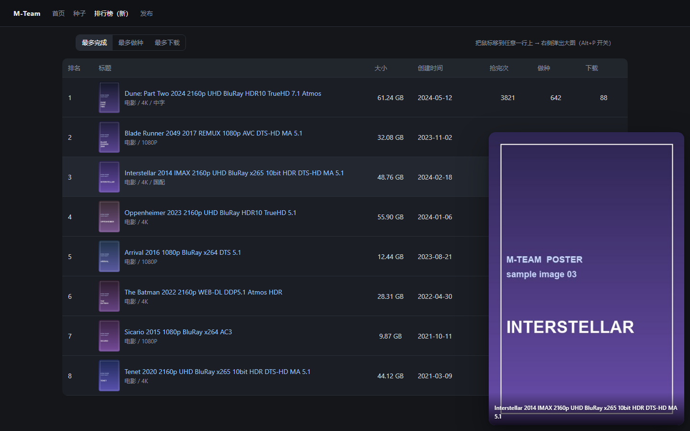

# M-Team 排行榜悬浮大图预览

一个油猴脚本（Tampermonkey / Violentmonkey）：在 M-Team 新版排行榜 [/rankings](https://kp.m-team.cc/rankings) 里，把鼠标移到任意一行上，就在行侧弹出这个种子的海报大图，不用点进详情页一张张看图。



## 功能

- **悬浮即看大图**：鼠标停在一行上约 110ms 后，在行的右侧弹出海报；右侧放不下时自动翻到左侧，再不够就贴着视口边缘并上下夹取，保证整张图始终在屏幕内。
- **自动挑图**：一行里可能有图标、旗帜、状态点和小缩略图，脚本按「面积 × antd 图片 × 竖版比例」打分，挑最像海报的那张。
- **大图优先**：表格里的缩略图通常就是原图，直接用；非表格的卡片列表会先试站点的大图变体（`xxx-1.jpg` → `xxxjp-1.jpg`），失败再回退原图。若加载出来的图明显偏小、而还有更大的候选，会自动换用更大的那张。
- **底部标题**：大图底部叠加种子标题（两行截断），方便确认是哪个资源。
- **随时开关**：右下角小圆角按钮 或快捷键 `Alt + P`，状态记在 `localStorage`，刷新后保持。
- **不打扰**：`pointer-events: none`，大图不会挡住点击；滚动、切标签页、前进后退时自动收起；选中文字时不弹。

## 安装

1. 浏览器安装 [Tampermonkey](https://www.tampermonkey.net/)（或 Violentmonkey / ScriptCat）。
2. 安装脚本，二选一：
   - 直接打开脚本地址，油猴会接管安装：
     `https://raw.githubusercontent.com/<你的用户名>/<仓库名>/main/m-team-rankings-hover-preview.user.js`
   - 或把 `m-team-rankings-hover-preview.user.js` 拖进浏览器窗口 / 在油猴面板里「新建脚本」后粘贴内容。
3. 打开 <https://kp.m-team.cc/rankings>，鼠标移到任意一行上即可。

> 首次安装后如果没反应，先刷新一次页面（脚本在 `document-idle` 时注入）。

## 使用

| 操作 | 效果 |
| --- | --- |
| 鼠标悬浮某一行 | 行侧弹出该种子的大图（约 0.1 秒后） |
| 移开鼠标 | 约 90ms 后淡出 |
| `Alt + P` | 全局开关预览 |
| 点击右下角「大图」按钮 | 同上，状态会被记住 |
| 按住 `Alt` 悬浮 | 临时不弹（方便按住 Alt 拖拽/选区） |

## 自定义

脚本顶部有一个 `CONFIG` 对象，改完保存（油猴里 Ctrl+S）刷新页面即生效：

| 配置项 | 默认值 | 说明 |
| --- | --- | --- |
| `paths` | `['/rankings']` | 生效的路径前缀。想让老版排行榜也生效就加 `'/top'` |
| `allPages` | `false` | `true` = 全站所有页面生效 |
| `rowSelector` | `tr.ant-table-row, tr[data-row-key], table.table-fixed tbody tr` | 「一行」的匹配选择器 |
| `thumbMinSize` | `32` | 缩略图最小可见边长，用来过滤小图标（antd 图片和详情链接里的图不受限） |
| `showDelay` / `hideDelay` | `110` / `90` | 弹出 / 收起的延迟（ms），调大可以更「稳重」 |
| `maxWidthRatio` / `maxHeightRatio` | `0.46` / `0.68` | 大图最多占视口宽 / 高的比例 |
| `maxWidthPx` | `760` | 大图宽度硬上限 |
| `minPreviewPx` | `140` | 大图最小边长，避免超宽图被压成一条 |
| `gap` | `16` | 大图与行之间的间距 |
| `showCaption` | `true` | 是否在底部显示标题 |
| `showToggleButton` | `true` | 是否显示右下角开关按钮 |
| `minViewportWidth` | `720` | 视口窄于该值时不启用（窄屏放不下） |
| `preferLargeMinWidth` | `360` | 加载结果小于该宽度时，尝试更大的候选图 |

## 工作原理

1. **事件委托**：只在 `window` 上挂 `pointerover` / `pointerout`（捕获阶段），不在每个行上绑监听。排行榜是 antd Table，翻页/切换排序会整批重渲染，委托式绑定不怕 DOM 被替换（参考脚本用的是逐元素 `mouseenter` + `MutationObserver`，行多时开销更大）。
2. **找行**：`event.target.closest(rowSelector)`。`pointerType` 不是 `mouse` 的直接忽略，触摸设备不会误弹。
3. **找图**：行内所有 `` 里打分选优——面积 × (antd image ? 2.5) × (详情链接内 ? 1.6) × (竖版 ? 1.4)，并跳过 `data:` 和 `.svg`。选中结果按行缓存在 `WeakMap` 里，行消失自动回收。
4. **取大图**：优先 `data-src` / `data-original`（懒加载站点常见），再退回 `currentSrc` / `src`；非表格场景尝试 `-123.jpg` → `jp-123.jpg` 大图变体，失败自动回退。加载用递增的 `token` 作废过期请求，快速划过十几行也不会串图。
5. **定位**：先 `display:block` 再读 `offsetWidth/offsetHeight`（强制布局），然后按「行右侧 → 行左侧 → 贴视口边缘」三级回退算 `left/top`，最后改 `opacity` 触发 0.16s 淡入。不用 `requestAnimationFrame` 显示，避免后台标签页/无头环境下 rAF 不回调导致预览一直透明。

## 适配别的页面

- 老版排行榜 `/top`：`paths: ['/rankings', '/top']`。
- 种子列表页、卡片视图：先 `allPages: true` 试一下；卡片视图的选择器通常需要把 `rowSelector` 换成 `li.list-none` 之类（参考脚本用的是 `li.list-none .ant-image[role='button']`）。

## 本地演示 / 回归测试

仓库里带了一个仿 antd Table 的演示页，方便改样式时看效果（不依赖 M-Team 账号）：

```bash
node demo/serve.mjs          # 需要 Node 18+
# 打开 http://localhost:8123/rankings
```

演示页会自动加载仓库根目录的脚本文件；`/rankings?autohover=3` 会在页面加载后自动悬浮第 3 行，方便截图对比。

## 排查

- 地址后加 `?mthp_debug=1`（或 `localStorage.setItem('mthp:debug','1')`）打开控制台日志，能看到每一行选中的图、候选大图地址、加载失败原因。
- 完全不弹：确认当前地址是 `/rankings`（`CONFIG.paths`）、窗口宽度 ≥ 720、右下角按钮是「大图」而不是「大图 关」。
- 弹出来但是空框/黑框：多半是缩略图地址取错或图片有防盗链，`?mthp_debug=1` 看候选地址是否 403。

## 已知限制

- 排行榜表格几乎占满屏幕时，大图会盖住表格右侧几列（`pointer-events: none`，不影响点击，但会挡视线）；把 `maxWidthRatio` 调小可以减轻。
- 大图用的是列表里的缩略图地址，站点若给的是压缩图，放大会有点糊。
- 只有行里存在 `` 时才有预览；纯文字的列表不会凭空变出海报。
- 站点是 SPA，脚本在 `document-idle` 注入，客户端路由切换后依然有效（每次悬浮都会重新判断路径）。

## 目录结构

```
m-team-rankings-hover-preview/
├── m-team-rankings-hover-preview.user.js   # 脚本本体（安装这个）
├── demo/
│   ├── index.html                          # 仿 antd Table 的演示页
│   ├── serve.mjs                           # 把演示页挂在 /rankings 的极简静态服务器
│   └── posters/                            # 演示用海报图
├── docs/preview.png                        # README 截图
├── LICENSE
└── README.md
```

## 致谢

- 交互与选择器思路参考了 [M-Team 新版页面主题 列表大图预览](https://greasyfork.org/zh-CN/scripts/538074)（作者 [Seahor](https://github.com/SeahorZhang/m-team-thems)），本脚本是独立实现，针对排行榜做了更轻量的委托式处理。
- 站点页面的类名/结构来自对 `kp.m-team.cc` 前端 bundle 的阅读，站点改版后可能需要同步调整选择器。

## License

[MIT](LICENSE)
